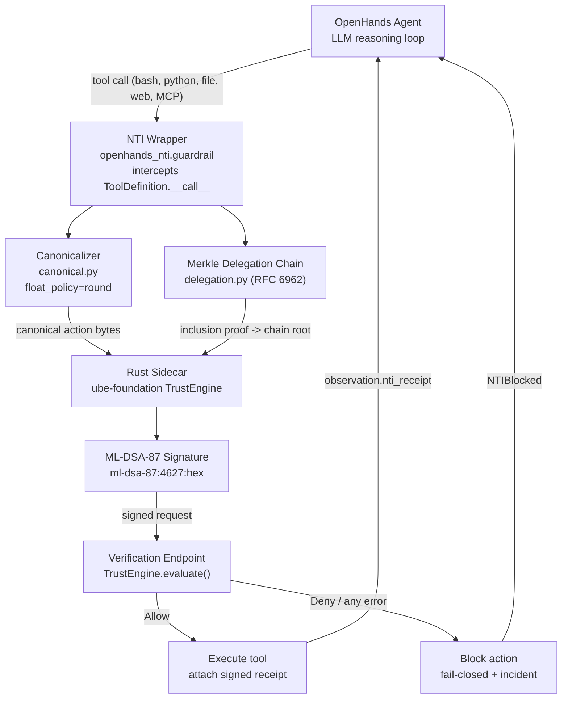
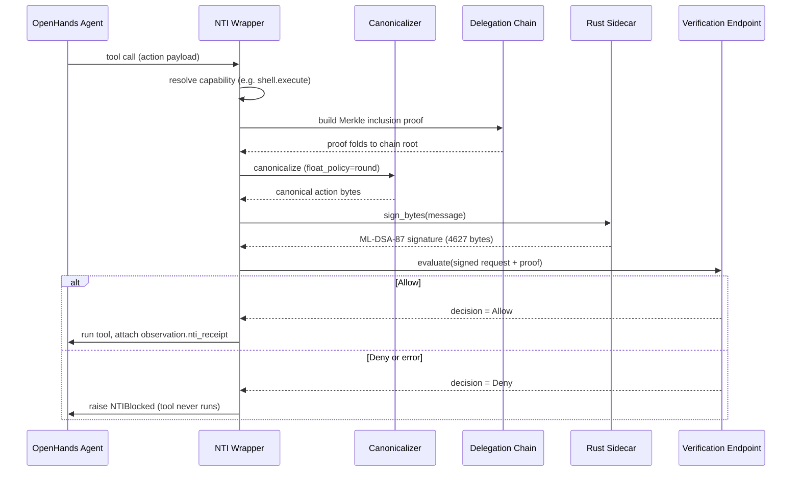

# Architecture

`openhands-nti` is the NTI wrapper for the OpenHands agent framework. It sits
between the agent loop and tool execution, and routes every action through the
NTI Rust sidecar for post-quantum signing and verification before the action is
allowed to run.

## Action flow

## The five stages

| # | Stage | Component | What it does |
| --- | --- | --- | --- |
| 1 | **OpenHands Agent** | `openhands.sdk` | The LLM loop decides on an action and calls a tool. |
| 2 | **NTI Wrapper** | `openhands_nti.guardrail` | Intercepts `ToolDefinition.__call__`, the single method every tool call funnels through. Resolves the action's NTI capability. |
| 3 | **Rust Sidecar** | `ube-foundation` (`TrustEngine`) | Receives the canonicalized action and the delegation proof. Holds the agent's registered ML-DSA-87 public key. |
| 4 | **ML-DSA-87 Signature** | `PqcKeyPair.sign_bytes` | Signs the action over `(id, actor, capability, action, input)`. Emitted as `ml-dsa-87:{length}:{hex}` — raw bytes, never DER/ECDSA. |
| 5 | **Verification Endpoint** | `TrustEngine.evaluate()` | Returns `Allow` or `Deny`. Only `Allow` lets the tool run; anything else blocks, fail-closed. |

## Sequence

## Fail-closed guarantee

Every failure path blocks execution: an undelegated capability, a delegation
proof that does not fold to the chain root, a non-`Allow` verdict, a payload
that cannot be canonicalized, or any unexpected internal error. The tool never
executes, and the incident is recorded before the exception is raised.

See [SECURITY.md](SECURITY.md) for the threat model and the float-canonicalization
hazard.

## Interactive diagram (gitdiagram)

Generate a live, navigable architecture map from this repository with
[gitdiagram.com](https://gitdiagram.com):

Direct link: <https://gitdiagram.com/abisheakp197/Openhands---nti>

> If the diagram does not render yet, it is because gitdiagram indexes public
> repositories on demand — open the link once and it will generate from the
> current `main` branch.
