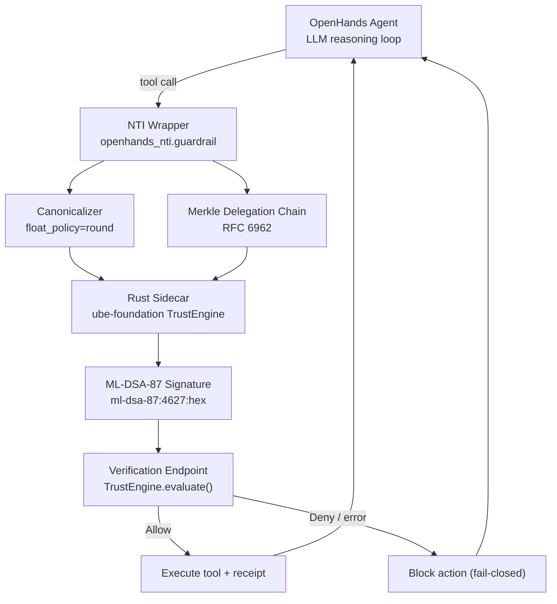

# openhands-nti

[](https://nti-leaderboard.vercel.app)
[](LICENSE)
[](https://nti-leaderboard.vercel.app)

Drop-in [Neutral Trust Infrastructure](https://github.com/abisheakp197/Neutral-Trust-Infrastructure)
(NTI) guardrail for the [OpenHands](https://github.com/OpenHands/software-agent-sdk)
agent framework.

**NTI Conformant.** This wrapper is verified against the NTI conformance suite
and ranked on the public [NTI leaderboard](https://nti-leaderboard.vercel.app).
Licensed under [Apache-2.0](LICENSE).

A one-line change intercepts **every** OpenHands action -- bash, Python
execution, file edits, browser and web requests, MCP tools, and client tools --
and wraps it in NTI verification: an ML-DSA-87 signature over the action and a
Merkle delegation-chain proof that the action is authorized, checked before the
tool runs. Denials fail closed.

```python
from openhands_nti import NTIGuardrail

NTIGuardrail(
    agent_did="did:webvh:z6Mk...:agents.example.com",
    key_pair=key_pair,               # ube_foundation.PqcKeyPair (ML-DSA-87)
    delegation_chain=delegation_chain,
).install()

# ... run your agent as usual ...
```

That is the whole integration. `install()` patches the single OpenHands method
every tool call funnels through, so no per-tool wiring is needed. Call
`uninstall()` (or use the guardrail as a context manager) to restore the
original behavior.

## What happens on every action

1. **Intercept.** `openhands.sdk.tool.tool.ToolDefinition.__call__` is wrapped.
   The sync agent loop and the async `acall` path both pass through it, so bash,
   the IPython tool, the file editor, browser/web tools, MCP tools, and client
   tools are all covered by one patch.
2. **Resolve the capability.** The tool name is mapped to an NTI capability
   (for example `bash` -> `shell.execute`). Override or extend the mapping.
3. **Prove delegation.** The delegation record granting that capability to the
   agent's DID must be included in the Merkle chain. The proof is folded back to
   the recomputed chain root; a mismatch fails closed.
4. **Sign.** The action is canonicalized and signed with ML-DSA-87 over the
   engine's exact signed tuple: `(request_id, actor, capability, action, input)`.
5. **Authorize.** The NTI `TrustEngine` returns a verdict. Anything other than
   `Allow` blocks the action.
6. **Execute and attest.** Only then does the original tool run, and the signed
   receipt is attached to its output as `observation.nti_receipt`.

If any step fails -- unknown capability, missing delegation record, bad
signature, engine denial, an unexpected error -- the tool **never executes**.
The incident is written to the audit trail and `NTIBlocked` is raised.

## Install

```bash
pip install openhands-nti            # core (ube-foundation)
pip install "openhands-nti[openhands]"  # + openhands-sdk
```

## Usage

### One-line install

```python
from openhands_nti import NTIGuardrail

guardrail = NTIGuardrail(
    agent_did=AGENT_DID,
    key_pair=key_pair,
    delegation_chain=chain,
).install()
```

### Context manager

```python
from openhands_nti import NTIGuardrail

with NTIGuardrail(agent_did=AGENT_DID, key_pair=key_pair, delegation_chain=chain):
    conversation.run()
```

### Reading receipts

Every allowed action returns an observation carrying a signed receipt:

```python
observation = bash_tool(BashAction(command="ls -la"))
receipt = observation.nti_receipt
# receipt["ml_dsa_87_signature"] -> "ml-dsa-87:4627:..."
```

Verify it against the agent's public key:

```python
from openhands_nti import verify_receipt

assert verify_receipt(receipt, key_pair)
```

### Custom capability mapping

```python
NTIGuardrail(
    agent_did=AGENT_DID,
    key_pair=key_pair,
    delegation_chain=chain,
    capability_overrides={"bash": "shell.execute", "my_custom_tool": "data.read"},
    # or fully custom:
    # capability_resolver=lambda tool_name: f"tool.{tool_name}",
).install()
```

## Delegation chain format

Each record is a JSON object. The guardrail hashes records with the NTI
reference construction:

* leaf: `sha256(b"nti-delegation-leaf-v1:" || canonical_json(record))`
* node: `sha256(b"nti-delegation-node-v1:" || left || right)`
* odd node: promoted unchanged (RFC 6962), never duplicated

```json
{
  "delegation_id": "sha256:root",
  "parent_delegation_id": null,
  "issuer": "did:webvh:z6MkIssuer...:issuer.example.com",
  "subject": "did:webvh:z6MkAgent...:agents.example.com",
  "scope": ["shell.execute", "file.write"],
  "issued_at": "2026-01-01T00:00:00Z",
  "depth_remaining": 2
}
```

## Security notes

* **Fail-closed.** Every failure path blocks the action. There is no "allow on
  error" mode.
* **ML-DSA-87, not DER/ECDSA.** Signatures are raw ML-DSA-87 bytes in the NTI
  tagged form `ml-dsa-87:{length}:{hex}`. `parse_tagged_signature` rejects
  DER/base64-looking input.
* **Canonicalization is a security boundary.** See [SECURITY.md](SECURITY.md)
  for the float-canonicalization hazard and the `float_policy` controls.

## Architecture



Full flow, stage table, sequence diagram, and a [gitdiagram.com](https://gitdiagram.com/abisheakp197/Openhands---nti)
link: see [ARCHITECTURE.md](ARCHITECTURE.md).

## Development

```bash
pip install -e ".[dev]"
pytest
```

The tests exercise the real `ube_foundation` bindings and the real
`openhands-sdk` execution path -- no mocks.

## License

[Apache License 2.0](LICENSE). See [LICENSE](LICENSE) for the full text.

## Conformance

This wrapper is **NTI Conformant** and tracked on the public
[NTI leaderboard](https://nti-leaderboard.vercel.app).
